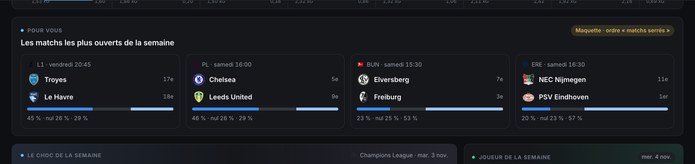
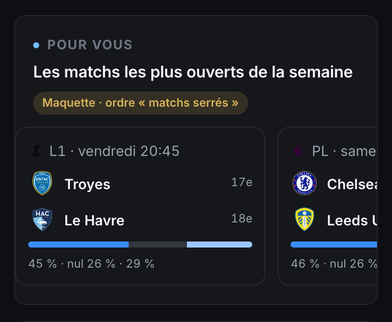

# Vega Sport : recommandation de l'accueil

Proposition du 14 novembre 2026 : rien de ce qui suit n'est construit ; les décisions qu'elle attend sont à la fin. Gardée dans le dépôt à partir du document partagé.

## Ce que l'on veut

L'accueil montre les mêmes matchs et les mêmes joueurs, dans le même ordre, à chaque visiteur. La recommandation ajoute une rangée, « Pour vous », en haut de la page de la semaine : quatre matchs choisis pour ce visiteur par l'un de quelques ordres fixes, et le site apprend quel ordre les visiteurs ouvrent le plus.

- **Ce qui ne change pas :** chaque carte existante, ses règles (match de la semaine, fil des résultats, meneurs) et le design. La nouvelle rangée prend le style des cartes voisines.
- **Ni compte, ni profil :** la rangée utilise ce que le navigateur garde déjà (clubs et joueurs suivis) et ce que la base calcule (pronostics, classements, projections).
- **Rien n'est personnalisé par un modèle entraîné sur une seule personne :** le site choisit entre des ordres identiques pour tous les visiteurs d'un même groupe, et compte lequel est cliqué.

## Comment l'accueil est ordonné aujourd'hui

Chaque visiteur reçoit les mêmes règles fixes ([accueil](01-accueil.md)) ; la seule donnée personnelle est la liste des clubs et joueurs qu'il suit, gardée dans son propre navigateur.

| Bloc | Règle actuelle |
| --- | --- |
| Fil des résultats | poids éditorial : 2 × grands clubs (une liste fixe de 29) + 3 pour la Ligue des champions, 1 pour la Ligue Europa ou la Ligue Conférence + 1 pour un championnat du Top 5 + 1 par équipe classée dans les trois premiers de son championnat |
| Match de la semaine | 4 × grands clubs + des points quand les deux équipes sont près du sommet, pour la Ligue des champions, pour le Top 5, pour des tirs disponibles ; à égalité, le plus récent |
| Matchs à venir | vos clubs suivis d'abord (les soirées européennes en tête ce jour-là), puis le poids éditorial, puis l'heure du coup d'envoi |
| Meneurs, séries, défenses | tableaux de la saison, les mêmes pour tous |

Rien ne dit quelle carte un visiteur ouvre. Vercel Web Analytics, déjà sur le site, compte les pages vues sans cookie ; il ne dit ni quelle carte a été cliquée, ni dans quel ordre les cartes étaient montrées.

## La proposition : quatre ordres, choisis par un bandit

La rangée est remplie par l'un des quatre ordres des matchs à venir de la semaine ; un bandit à échantillonnage de Thompson choisit l'ordre de chaque visite et oriente les visites vers celui que les visiteurs cliquent le plus.

| Ordre | Met en premier | Construit à partir de |
| --- | --- | --- |
| A. Éditorial (la règle actuelle, la référence) | le poids éditorial le plus haut | la règle ci-dessus |
| B. Vos équipes | les matchs des clubs suivis et des clubs des joueurs suivis, puis leurs championnats, puis le poids | les listes gardées par le navigateur |
| C. Matchs serrés | les matchs les plus ouverts : le plus petit écart entre les chances de victoire à domicile et à l'extérieur de notre pronostic | `/api/forecasts/match` (forme et compositions confirmées comprises) |
| D. Enjeu au classement | les deux clubs dans les quatre premiers ou les trois derniers de la projection de leur championnat | `/api/forecasts/season` |

- **Groupes de visiteurs :** nouveau, revenant avec des clubs suivis, revenant sans. Chaque groupe a ses propres comptes : l'ordre B peut gagner auprès des visiteurs qui suivent des clubs et perdre auprès des autres.
- **Un ordre par visite :** choisi une fois à l'ouverture de la page et gardé pour la visite, pour que la rangée ne se réordonne jamais sous les yeux du lecteur.
- **Choix :** pour chaque ordre et chaque groupe, une loi Bêta(1 + clics, 1 + vues sans clic) ; chaque visite tire une valeur par ordre et montre la plus haute. Chaque ordre garde au moins 10 % des visites pendant les deux premières semaines.
- **Récompense :** un clic sur l'une des quatre cartes de la rangée pendant la visite.

### Pourquoi ce choix

La probabilité qu'un ordre soit cliqué est inconnue ; après c clics sur v vues, avec un a priori uniforme Bêta(1, 1), elle suit la loi Bêta(1 + c, 1 + v − c). Tirer une valeur par ordre et montrer la plus haute montre chaque ordre avec la probabilité qu'il soit le meilleur : un ordre encore peu vu garde sa chance, un ordre nettement moins cliqué la perd peu à peu. Le plancher de 10 % pendant deux semaines évite qu'un ordre soit écarté sur quelques visites.

## Ce qui est enregistré

Deux sortes d'événements, une vue de la rangée et un clic sur l'une de ses cartes, sans compte, sans adresse IP et sans rien qui suive un visiteur d'un jour à l'autre.

| Champ | Exemple | Pourquoi |
| --- | --- | --- |
| Événement | vue, clic | la récompense |
| Minute | 2026-11-21 15:04 | les comptes du jour |
| Visite | un identifiant aléatoire, nouveau à chaque session d'onglet, jamais gardé au-delà | un ordre par visite, une récompense par visite |
| Groupe | nouveau, revenant avec des clubs suivis, revenant sans | les comptes du bandit |
| Ordre | A, B, C, D | ce que la visite a montré |
| Carte | sa position (1 à 4) et l'identifiant Vega du match | la carte qui a attiré le clic |

- **Stockage :** des lignes typées dans une nouvelle table `ops.home_events`, une partition par jour, effacées après 90 jours ; le worker les additionne chaque nuit dans `agg.home_bandit` (ordre, groupe, vues, clics), seule table que lit le bandit.
- **Écriture :** l'API de lecture reste en lecture seule. Une petite route à part reçoit les événements (envoyés par lots quand l'onglet est masqué, `navigator.sendBeacon`), vérifie le type de chaque champ et écrit avec un rôle qui ne peut qu'insérer dans cette table.
- **Vie privée :** enregistrer la carte qu'un visiteur clique est nouveau pour le site. Faut-il un bandeau de consentement, ou est-ce une mesure d'audience anonyme qui n'en demande pas ? C'est à vérifier auprès des règles de la CNIL avant tout enregistrement.

## Comment on le juge

Un ordre n'est gardé que si plus de visites cliquent dans la rangée avec lui qu'avec l'ordre éditorial actuel ; les autres sont abandonnés.

- **Mesure principale :** la part des visites qui cliquent sur l'une des cartes de la rangée, par ordre et par groupe.
- **Surveillé à côté :** la part des visites qui cliquent sur n'importe quel élément de l'accueil (la rangée ne doit pas prendre les clics des cartes du dessous), et les visites de retour sous sept jours.
- **Abandon d'un ordre :** dès que lui et l'ordre A ont chacun 2 000 visites dans un groupe, il est abandonné pour ce groupe si sa chance de battre A, lue sur les deux lois Bêta, est sous 5 %.
- **Durée :** distinguer une part de clics de 10 % d'une part de 12 % demande environ 3 800 visites par ordre (5 % de fausse alerte, puissance de 80 %). Les 10 % sont une hypothèse : les deux semaines d'enregistrement ci-dessous donnent le vrai chiffre, et avec lui la durée du test.
- **Compte rendu :** les comptes par ordre et par groupe chaque semaine, sur la page d'état.

### D'où vient le chiffre de 3 800

Pour deux proportions p₁ = 0,10 et p₂ = 0,12, un test bilatéral au seuil α = 5 % (z = 1,96) avec une puissance de 80 % (z = 0,84) demande par groupe

n = (1,96 × √(2 p̄ (1 − p̄)) + 0,84 × √(p₁(1 − p₁) + p₂(1 − p₂)))² / (p₂ − p₁)², avec p̄ = (p₁ + p₂) / 2 = 0,11,

soit n = (1,96 × 0,4425 + 0,84 × 0,4427)² / 0,02² ≈ 3 840 visites par ordre.

## Étapes de construction

La rangée peut être construite et montrée avec le seul ordre A avant tout enregistrement ; l'enregistrement attend la décision sur la vie privée.

1. **La rangée, ordre A seul.** « Pour vous » sur la page de la semaine, quatre matchs à venir selon le poids éditorial actuel. Aucun enregistrement, rien ne change ailleurs sur la page.
2. **Les ordres B, C et D dans le code**, chacun testé sur les vrais matchs de la semaine ; une visite voit toujours A.
3. **L'enregistrement** (après la décision ci-dessous) : la table, ses sommes de la nuit, la route qui ne fait qu'insérer et les événements envoyés par lots par le site. Deux semaines avec A seul : la part de clics de référence, et la vérification que vues et clics se correspondent.
4. **Le bandit en marche :** l'API sert les comptes de chaque groupe ; le site tire un ordre par visite à partir d'eux.
5. **Compte rendu hebdomadaire** sur la page d'état, et la règle d'abandon appliquée à la main le premier mois.

## Maquette

La rangée telle qu'elle se placerait sur la page de la semaine, au-dessus du match de la semaine, remplie ici par l'ordre C avec les vrais matchs à venir et nos vrais pronostics du 14 novembre 2026. Seul le choix de l'ordre est inventé, et le badge le dit ; les captures viennent d'une copie locale du site, rien n'a été mis sur le site en ligne.

Sur téléphone, les quatre matchs deviennent une seule rangée qui défile sur le côté, comme les filtres, jamais une pile de quatre cartes.

## Décisions à prendre

- [ ] Enregistrer la carte qu'un visiteur clique : oui ou non, et avec un bandeau de consentement ou comme mesure d'audience anonyme (à vérifier d'abord auprès des règles de la CNIL).
- [ ] Les quatre ordres à tester : A à D comme ci-dessus, ou d'autres.
- [ ] La place de la rangée : en haut de la page de la semaine (la maquette), ou dans « Matchs à venir » à la place de son ordre actuel.
- [ ] L'étape 1 maintenant : la rangée avec l'ordre A, sur le site en ligne, sans rien enregistrer.
